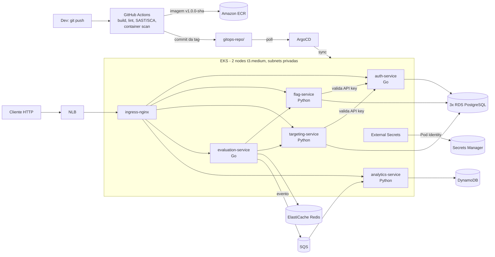

# ToggleMaster - Fase 3: IaC, DevSecOps e GitOps

Infraestrutura e ciclo de vida dos 5 microsserviços do **ToggleMaster** (sistema de feature flags) na AWS, totalmente em código:

- **Terraform** provisiona toda a infraestrutura (VPC, EKS, RDS, ElastiCache, DynamoDB, SQS, ECR, Secrets Manager, IAM).
- **GitHub Actions** faz o CI com estágios de DevSecOps e bloqueia o pipeline em vulnerabilidade crítica.
- **ArgoCD** faz o CD por GitOps: o CI só grava a tag nova da imagem no Git, e o ArgoCD sincroniza o cluster.
- **Nenhuma credencial em arquivo**: senhas no AWS Secrets Manager (lidas pelo External Secrets) e acesso à AWS via EKS Pod Identity.

---

## Arquitetura



| Serviço | Linguagem | Porta | Dados | Acesso à AWS |
|---|---|---|---|---|
| auth-service | Go | 8001 | RDS `auth_db` | - |
| flag-service | Python | 8002 | RDS `flags_db` | - |
| targeting-service | Python | 8003 | RDS `targeting_db` | - |
| evaluation-service | Go | 8004 | Redis (cache) | SQS `SendMessage` (Pod Identity) |
| analytics-service | Python | 8005 | DynamoDB | SQS consumo + DynamoDB `PutItem` (Pod Identity) |

---

## Estrutura do repositório

```
.
├── .github/workflows/          # 1 workflow de CI por serviço (<serviço>-ci.yaml)
├── terraform/
│   ├── environments/prod/      # Composição dos módulos, backend S3, outputs
│   └── modules/                # networking, eks, rds, elasticache, dynamodb, sqs, ecr,
│                               # secrets-manager, external-secrets, pod-identity
├── gitops-repo/                # Única fonte da verdade do que roda no cluster
│   ├── applications/
│   │   ├── <serviço>-app.yaml  # Application do ArgoCD (uma por serviço)
│   │   └── <serviço>/
│   │       ├── base/           # Deployment, Service, Ingress, HPA, ExternalSecret, ...
│   │       └── overlays/production/   # namespace, patch e TAG DA IMAGEM (alterada pelo CI)
│   └── infrastructure/         # ClusterSecretStore (External Secrets -> Secrets Manager)
├── metrics-server.yaml         # Necessário para os HPAs
└── <serviço>/                  # Código-fonte, Dockerfile e README de cada microsserviço
```

---

## Pipeline de CI (DevSecOps)

Cada serviço tem seu workflow, disparado em **pull request e push na `main`** quando a pasta do serviço (ou o próprio workflow) muda.

| # | Job | Go (auth, evaluation) | Python (flag, targeting, analytics) |
|---|---|---|---|
| 1 | Build & Test | `go build`, `go test` | `compileall`, `pytest` |
| 2 | Lint | golangci-lint | flake8 |
| 3 | Security (SCA) | Trivy `fs` | Trivy `fs` |
| 3 | Security (SAST) | gosec | bandit |
| 4 | Docker | build, **Trivy image**, push no ECR | build, **Trivy image**, push no ECR |
| 5 | Update GitOps | `kustomize edit set image` + commit na `main` | idem |
| 6 | Summary | resumo no `GITHUB_STEP_SUMMARY` | idem |

- **Regra de bloqueio:** Trivy com `--severity CRITICAL --exit-code 1` (dependências e imagem). Uma CVE crítica falha o job e os seguintes não rodam: a imagem não é publicada e a tag não chega ao GitOps.
- **Tag da imagem:** `v1.0.0-<sha7 do commit>`.
- **Push e GitOps só em push na `main`** com a variável de repositório `ENABLE_ECR_PUSH=true`. Em PR o pipeline só valida.
- **Sem loop:** o commit da tag é feito com o `GITHUB_TOKEN` (que não dispara workflows) e fica em `gitops-repo/`, fora do filtro `paths` do CI.

---

## Entrega contínua (GitOps)

1. O job `update-gitops` altera `newTag` em `gitops-repo/applications/<serviço>/overlays/production/kustomization.yaml` e faz commit.
2. O ArgoCD (uma Application por serviço, `automated` com `prune` e `selfHeal`) detecta o commit e aplica o overlay no namespace do serviço.
3. Nos serviços com banco, um Job `db-init-<serviço>` (hook de Sync) roda o `init.sql` no RDS, que o Terraform cria vazio.

Nada é aplicado no cluster por `kubectl apply` no dia a dia: o que está no Git é o que roda.

---

## Segredos e credenciais

- O **Terraform** gera as senhas (RDS, `MASTER_KEY` do auth, API key do evaluation) e grava no **AWS Secrets Manager** (`fase03-fiap/<serviço>`).
- O **External Secrets Operator** lê esses segredos e cria os `Secret` no cluster. No Git ficam só referências.
- O **EKS Pod Identity** liga roles de IAM a ServiceAccounts: o ESO, o evaluation e o analytics recebem credenciais temporárias com permissão mínima, sem access keys.
- A API key do evaluation (usada para chamar flag e targeting) é cadastrada no auth automaticamente: o Terraform guarda só o **hash SHA-256** no segredo do auth, e o Job `db-init` grava esse hash na tabela `api_keys`.

---

## Como subir o ambiente

Pré-requisitos: AWS CLI configurado na conta do projeto, Terraform >= 1.10, kubectl, Helm, Git Bash. O bucket S3 do state (`fase03-fiap`) é criado fora deste Terraform.

```bash
# 1. Infraestrutura (~15-20 min)
cd terraform/environments/prod
terraform init
terraform plan -out tfplan && terraform apply tfplan && rm tfplan
cd ../../..
aws eks update-kubeconfig --name fase03-fiap-eks --region us-east-1

# 2. Componentes do cluster
kubectl apply -f metrics-server.yaml

helm repo add ingress-nginx https://kubernetes.github.io/ingress-nginx
helm install ingress-nginx ingress-nginx/ingress-nginx -n ingress-nginx --create-namespace --version 4.15.1 \
  --set controller.replicaCount=1 \
  --set-string controller.service.annotations."service\.beta\.kubernetes\.io/aws-load-balancer-type"=nlb

helm repo add external-secrets https://charts.external-secrets.io
helm install external-secrets external-secrets/external-secrets -n external-secrets --create-namespace --version 2.11.0
kubectl wait --for=condition=Ready pods --all -n external-secrets --timeout=180s
kubectl apply -f gitops-repo/infrastructure/cluster-secret-store.yaml

# 3. ArgoCD
kubectl create namespace argocd
kubectl apply -n argocd --server-side --force-conflicts \
  -f https://raw.githubusercontent.com/argoproj/argo-cd/v3.5.5/manifests/install.yaml
kubectl wait --for=condition=Ready pods --all -n argocd --timeout=300s
```

4. **Imagens:** o ECR é recriado vazio. Rode de novo (Actions > Re-run) o CI de cada serviço no commit da tag que está no overlay.
5. **Conectar o repositório no ArgoCD** (`kubectl port-forward svc/argocd-server -n argocd 8080:443`, usuário `admin`, senha em `argocd-initial-admin-secret`): *Settings > Repositories > Connect Repo*, HTTPS, Project `default`, usuário do GitHub + PAT fine-grained com `Contents: Read-only`. A URL deve ser idêntica ao `repoURL` das Applications.
6. **Applications:**
   ```bash
   for s in auth flag targeting evaluation analytics; do
     kubectl apply -f gitops-repo/applications/$s-service-app.yaml
   done
   kubectl get applications -n argocd     # Synced / Healthy
   ```

### Testar

```bash
NLB=$(kubectl get svc ingress-nginx-controller -n ingress-nginx -o jsonpath="{.status.loadBalancer.ingress[0].hostname}")
KEY=$(kubectl get secret opaque-evaluation-service -n evaluation-service -o jsonpath="{.data.SERVICE_API_KEY}" | base64 -d)

curl -X POST http://$NLB/flags/flags -H "Authorization: Bearer $KEY" -H "Content-Type: application/json" \
  -d '{"name": "enable-new-dashboard", "description": "demo", "is_enabled": true}'
curl -X POST http://$NLB/targeting/rules -H "Authorization: Bearer $KEY" -H "Content-Type: application/json" \
  -d '{"flag_name": "enable-new-dashboard", "is_enabled": true, "rules": {"type": "PERCENTAGE", "value": 50}}'
curl "http://$NLB/evaluation/evaluate?user_id=user-1&flag_name=enable-new-dashboard"

aws dynamodb scan --table-name ToggleMasterAnalytics --region us-east-1 --max-items 5
```

Rotas públicas: `/auth`, `/flags`, `/targeting`, `/evaluation`, `/analytics` (o prefixo é removido antes de chegar ao serviço).

## Como derrubar

```bash
kubectl delete applications --all -n argocd
helm uninstall ingress-nginx -n ingress-nginx     # obrigatório: o NLB não é do Terraform e trava o destroy da VPC
aws elbv2 describe-load-balancers --region us-east-1 --query "LoadBalancers[].LoadBalancerName"   # esperar []
cd terraform/environments/prod
terraform plan -destroy -out tfplan && terraform apply tfplan && rm tfplan
```

---

## Principais decisões

- **Conta AWS pessoal (Opção B do enunciado):** o Terraform cria as roles de IAM, inclusive as de Pod Identity.
- **Monorepo com `gitops-repo/`:** o enunciado aceita pasta separada; segue o modelo da aula (Kustomize base + overlay, uma Application por serviço).
- **2 nodes t3.medium:** no EKS cada pod usa um IP da VPC, e um t3.medium comporta 17 pods. Com ArgoCD, External Secrets, ingress e 5 serviços com 2 réplicas, 1 node não basta. Os dois nodes ficam em AZs diferentes.
- **HPA (2 a 4 réplicas) sem `replicas` fixo no Deployment:** senão o `selfHeal` do ArgoCD desfaria cada escala do HPA.
- **External Secrets em vez de Sealed Secrets:** o Terraform grava as senhas direto no cofre, sem passo manual de selar, e a recriação do cluster não exige nada novo.
- **Pod Identity em vez de access keys** para SQS/DynamoDB: credenciais temporárias e permissão mínima por serviço.
- **API key do evaluation gerada pelo Terraform:** recriar o ambiente não exige gerar e cadastrar chave na mão.
- **RDS e Redis em uma única AZ, sem réplica:** escolha de custo para o ambiente acadêmico.
- **ingress-nginx:** usado por ser o mesmo da Fase 2. O projeto foi aposentado pela comunidade Kubernetes em 2026; em produção, a alternativa seria o AWS Load Balancer Controller ou Gateway API.
